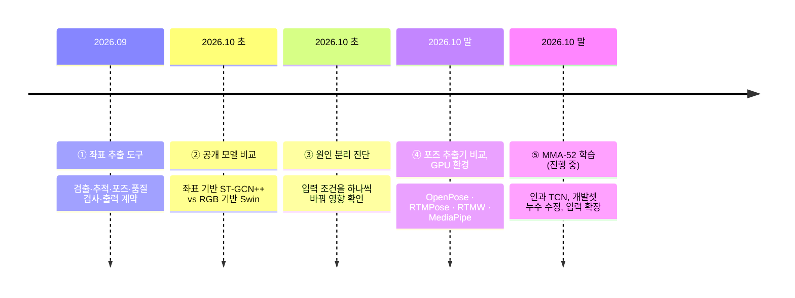
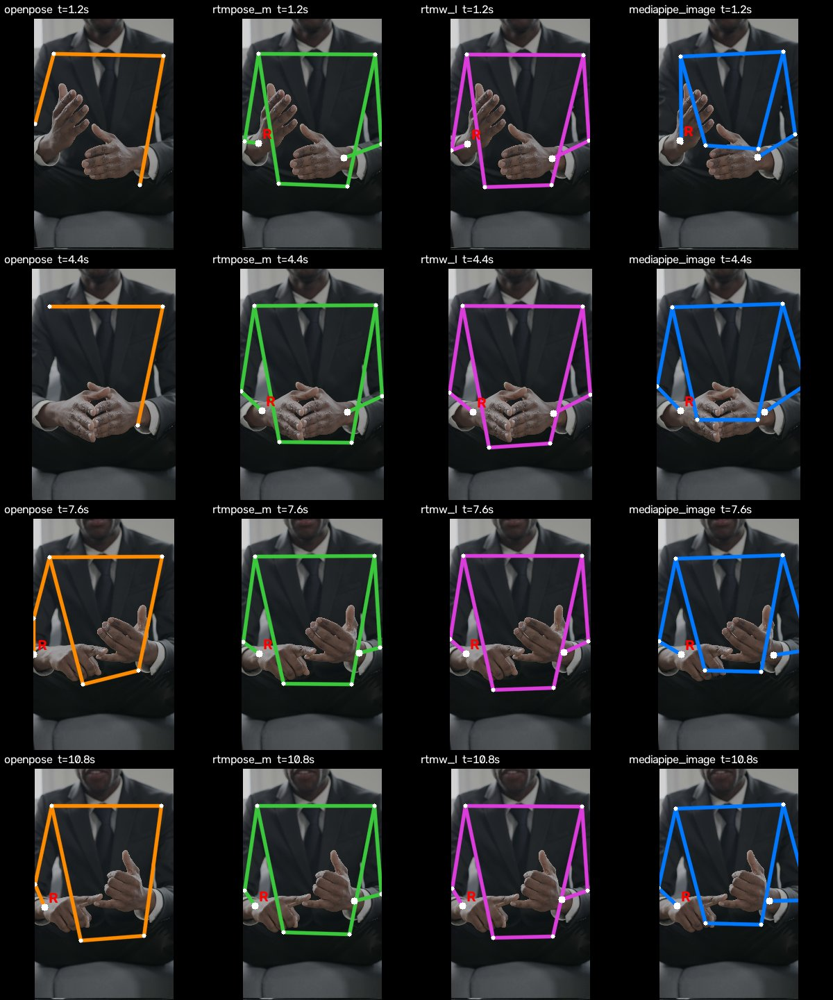

# Upper-Body Action Recognition

> **진행 중인 연구의 초안입니다.** 2026.10 말까지의 실험을 정리했고, 최종 모델은 아직 정하지 않았습니다.

**화상 대화 영상에서 사람의 상반신 행동("오른팔을 옆으로 뻗음", "팔짱을 유지함")을 실시간으로 인식하는 모듈 연구**

| | |
|---|---|
| 과제 | 정부 지원 연구과제 (연구실 수행). 비언어 행동과 음성·텍스트를 결합한 대화 이해 과제 중 **영상 기반 상반신 행동 인식 모듈 담당** |
| 기간 | 2026.09 ~ 진행 중 |
| 현재 상태 | 공개 모델 진단 완료 → MMA-52로 인과적(과거만 보는) 행동 인식 모델 학습 중 |
| 핵심 기술 | RTMPose/RTMW, ST-GCN++, Video Swin, 인과 TCN/GRU, YOLOX + ByteTrack, ONNX Runtime |
| 환경 | RTX 5070 12GB |

---

## 목표와 범위

과제 전체는 표정·몸짓 같은 비언어 행동을 음성·텍스트와 결합해 대화를 더 잘 이해하는 것입니다. 이 저장소는 그중 **영상에서 관찰 가능한 상반신 행동을 뽑아내는 부분**입니다. 음성·어조 분석과 유해성 판단은 다른 연구원이 맡고 있습니다.

원칙:

- 출력은 **관찰 가능한 사실**입니다. "팔짱 = 반대", "다리 떨기 = 거짓말" 같은 해석은 하지 않습니다. 감정·의도 추론은 이후 결합 모듈의 몫입니다.
- 새 모델부터 설계하지 않고, **검증된 공개 모델과 가중치를 먼저 재사용**합니다.
- 결과는 음성·텍스트와 결합할 수 있도록 JSON 계약으로 내보냅니다. 사람이 보는 한글 자막 영상은 점검용입니다.

## 연구 흐름



### ① 좌표 추출 도구

`영상 → YOLOX 사람 검출 → ByteTrack 추적 → RTMPose 17점 → 기하 품질 검사 → 행동 후보 → JSON + 한글 점검 영상`

- 포즈 점수로 좌표를 거르지 않습니다. 점수는 확률이 아니어서, 대신 좌표 범위·어깨 폭·뼈 길이·급격한 점프를 검사합니다. 빠르지만 일관된 움직임은 점프로 잘못 지우지 않게 했습니다.
- 장면 전환(컷)을 감지해 추적과 행동 이력을 초기화합니다.
- 프레임별 관찰 결과(`observations.jsonl`)와 행동 구간(`action_updates.jsonl`)을 분리해 저장하고, 음성 결합용 발화 단위 벡터 계약을 미리 정해 두었습니다.
- 계약 테스트 5개 통과 (점수 불변성, 비정상 좌표, 빠른 움직임 보존, 컷, 짧은 결측).

### ② 공개 모델 비교: "실제 영상에서는 원하는 행동이 안 나온다"

두 모델을 병렬로 붙였습니다.

| | ST-GCN++ | Video Swin Tiny |
|---|---|---|
| 입력 | 2D 관절 좌표 | RGB 프레임 |
| 사전학습 | NTU120 (120종) | iMiGUE (32종) |
| 출력 | 클립 전체 분류 | 클립 전체 분류 |

팔짱을 유지하는 공개 영상에서 Swin은 8개 창 중 2개만 팔짱으로, 6개는 입술 관련 행동으로 분류했습니다. 설명하는 손짓 영상에서는 거의 모든 창이 "포괄적 몸짓"으로 나왔습니다. 두 모델은 데이터·클래스·입력이 모두 달라서 어느 쪽이 낫다고 비교하지 않았습니다.

### ③ 원인 분리 진단: "추측 대신 조건을 하나씩"

"하체가 안 보여서 못 맞힌다", "입력이 짧아서 그렇다" 같은 추측을 하나씩 확인했습니다. NTU120 공개 검증 샘플 30개(6개 행동 × 5개)에 한 가지 조건만 바꿔 넣었습니다.

| 조건 | 맞힌 수 (30개 중) |
|---|---:|
| 원본, 10클립 | 24 |
| 원본, 1클립 | 23 |
| 하체 좌표 제거 | 20 |
| 좌표 크기 2배 | 19 |
| 마지막 25%만 | 3 |
| 가운데 한 프레임 복제 | 0 |

- **팔 교차(팔짱) 5개는 하체를 지워도 5/5였습니다.** 그래서 "하체가 없어서 팔짱을 못 맞힌다"는 가설을 기각했습니다.
- 짧은 입력을 채우는 방식만 바꿔도 결과가 4/30, 1/30, 13/30으로 달라졌습니다.
- 좌표는 그대로 두고 포즈 점수 채널만 다른 추출기의 것으로 바꾸자(RTMPose 중앙값 0.92 vs RTMW 8.78) 예측이 "가리키기"에서 "큐브 조작"으로 바뀌었습니다.
- 같은 종료 시점에서 입력을 1·2·4초로 줄여 봤지만, 길이만 바꿔서는 원하는 인식이 나오지 않았습니다.

결론: 공개 클립 분류기를 그대로 쓰는 데는 한계가 있고, **목표 행동에 맞는 시간 주석 데이터로 학습해야 합니다.** 이 표본은 작은 진단용이며 정확도 수치가 아닙니다.

### ④ 포즈 추출기 비교와 GPU 환경

과제 제안서의 OpenPose와 대안들을 같은 사람 박스로 비교했습니다. 정답 좌표가 없어서 결측·흔들림·모델 간 합의를 봤습니다.


<sub>왼쪽부터 OpenPose, RTMPose-m, RTMW-l, MediaPipe. 손이 가까이 크게 잡히면 OpenPose(주황)가 손목을 놓칩니다. 영상: [Pexels 6100890](https://www.pexels.com/video/6100890/)</sub>

| 모델 | 손목 결측 | 손목 흔들림 | 프레임당 시간 (CPU) |
|---|---:|---:|---:|
| OpenPose | 22.4% | 0.009 | (파이썬 포팅이라 비교 제외) |
| RTMPose-m | 0% | 0.011 | 12ms |
| **RTMW-l** | 0% | **0.007** | 85ms |
| MediaPipe (IMAGE) | 0% | 0.030 | 53ms |

흔들림은 어깨 너비 대비 비율입니다. 가장 안정적이고 손 좌표까지 내는 **RTMW-l을 주 추출기**로 정했고, OpenPose는 제안서 기준선으로만 남겼습니다.

GPU 환경을 새로 만들면서 기존 CPU 결과와 같은지 먼저 검증했습니다.

- CUDA FP32 출력과 CPU 출력의 확률 차이 1e-6 미만, top1·top5 순서 모두 일치
- TF32를 켜면 차이가 1e-3으로 커져 한 창에서 top5 순서가 바뀜 → **기존 결과와 비교할 때는 TF32를 끔**
- Swin 한 창 계산 1.24초 → 0.039초 (약 33배)

### ⑤ MMA-52 학습 (진행 중)

연속 다중 행동에 시간 주석이 있는 MMA-52(비상업 학술 연구 동의서 승인)로 학습을 시작했습니다.

- train·val 영상 6,009개, 약 186만 프레임에서 RTMW-l 133점을 추출했습니다. 오류 0, GPU 추출 결과는 CPU와 0.0001px 이내로 같았습니다.
- 입력: 상반신 13점의 좌표 + 속도 + 점수. 다리·발 라벨 12종은 빼고 40종을 프레임별 다중 라벨로 학습합니다.
- 모델: **과거 프레임만 보는 인과적 TCN**(수용 범위 약 4.2초)과 GRU. 미래 프레임을 바꿔도 과거 출력이 변하지 않는지 먼저 검사했습니다.

**개발셋 누수 발견**: 처음에는 train 영상의 10%를 무작위로 떼어 개발셋으로 썼는데, 개발셋 mAP 0.483 대비 공식 val은 0.147이었습니다. 팔짱은 0.93 대 0.05였습니다. 같은 사람이 양쪽에 섞여 사람의 자세 습관을 외운 것이었습니다. 데이터에 사람 ID가 없어서 옷 색 히스토그램으로 영상을 사람 단위로 묶어 다시 나눴고, 이후 개발셋 수치가 val과 맞게 됐습니다.

| 설정 (공식 val, 사람 미중복) | mAP |
|---|---:|
| 우연 수준 | 0.032 |
| GRU | 0.100 ± 0.003 |
| TCN, 몸 13점 | 0.142 ± 0.015 |

| 입력 확장 (머리 동작 제외 24종) | 단일 모델 mAP | 3시드 앙상블 |
|---|---:|---:|
| 몸 13점 | 0.154 ± 0.018 | 0.174 |
| **몸 13점 + 양손 중심점** | **0.186 ± 0.008** | **0.194** |

- 손이 몸·얼굴에 닿는 행동(얼굴 만지기 0.52, 몸 만지기 0.51)은 좌표만으로 우연 수준의 6~13배를 배웠습니다.
- 머리 동작은 몸 좌표만으로는 거의 못 배웠습니다. 얼굴 점을 따로 처리하는 두 갈래 TCN에서 끄덕임이 0.10 → 0.29로 올랐습니다.
- 손 중심점 두 개를 더하자 가장 크게 개선됐고 시드 편차도 줄었습니다.
- 손 흔들기·팔 뻗기·팔짱 같은 **큰 팔 동작은 여전히 약합니다**(평균 AP 0.135). MMA-52는 미세 행동 데이터셋이라, 같은 이름이라도 동작이 작아서 이 과제의 목표 행동과 어긋납니다.

## 다음 단계

1. 목표 행동과 시작·끝 기준을 정의하고, 학습에 쓰지 않은 인물·영상으로 평가 세트 구성
2. 큰 팔 동작이 담긴 자체 데이터 확보 (수집 요청서 작성 완료)
3. 좌표 추출을 포함한 전체 실시간 처리 속도 측정
4. 인식 결과를 음성·텍스트와 결합했을 때 대화 이해가 좋아지는지 검증

## 실험에서 바꾼 판단

| 상황 | 바꾼 판단 |
|---|---|
| "하체가 없어서 팔짱을 못 맞힌다"는 추측 | 하체를 지운 진단에서 팔짱 5/5 → 가설 기각 |
| 무작위 개발셋에서 mAP 0.48 | 사람 단위 누수였음. 사람 군집 단위로 분할 |
| 점수 채널만 바꿔도 예측이 바뀜 | 추출기를 바꿀 때 점수 분포까지 맞춰야 함 |
| TF32를 켜면 결과 순서가 바뀜 | 기존 결과와 비교하는 실험에서는 TF32를 끔 |
| 제안서의 OpenPose가 가까운 구도에서 손목을 놓침 | 근거를 남기고 RTMW-l로 교체, OpenPose는 기준선 유지 |
| 공개 데이터의 행동 이름이 목표와 같아도 동작 크기가 다름 | 이름이 아니라 실제 영상과 주석을 보고 데이터를 판단 |

## 데이터와 라이선스

- MMA-52는 비상업 학술 연구 동의서를 받아 사용했습니다. 데이터와 파생 라벨, 추출 좌표는 공유하지 않으며 이 저장소에도 넣지 않았습니다.
- 공개 테스트 영상은 Pexels 영상을 사용했습니다. AI-Hub 영상은 재배포하지 않습니다.
- 사전학습 가중치(PYSKL ST-GCN++, MM-Gesture Swin, MMN)와 원본 구현은 각 저장소에서 받아야 합니다.

## 저장소 구조

```
src/
  behavior_tool/       ① 좌표 추출 도구 (analyze.py, core.py, 계약 테스트, 출력 계약)
  behavior_module/     공개 모델 어댑터 (ST-GCN++, MMN)
  seated_references/   ② ST-GCN++ vs Swin 비교
  pose_compare/        ④ 포즈 추출기 비교
  gpu_parity/          ④ CPU/GPU 출력 동등성 검증
  mma52_pose/          ⑤ MMA-52 RTMW 좌표 추출
  mma52_train/         ⑤ 사람 군집 분할, 캐시, 인과 TCN/GRU 학습, 실사용 평가
diagnostics/           ③ 원인 분리 진단 스크립트
docs/
  cause_isolation_notes_ko.txt   원인 분리 결론 원문
```

## 역할

과제 중 영상 기반 상반신 행동 인식 모듈을 맡아 좌표 추출 도구, 공개 모델 진단, 포즈 추출기 선정, GPU 환경 검증, MMA-52 학습까지 수행하고 있습니다. 구현에는 AI 코딩 도구를 적극 활용했고, 실험 설계·판단 기준·결과 해석은 직접 수립했습니다.
